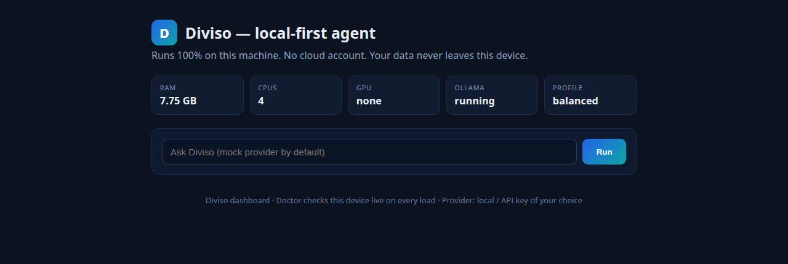
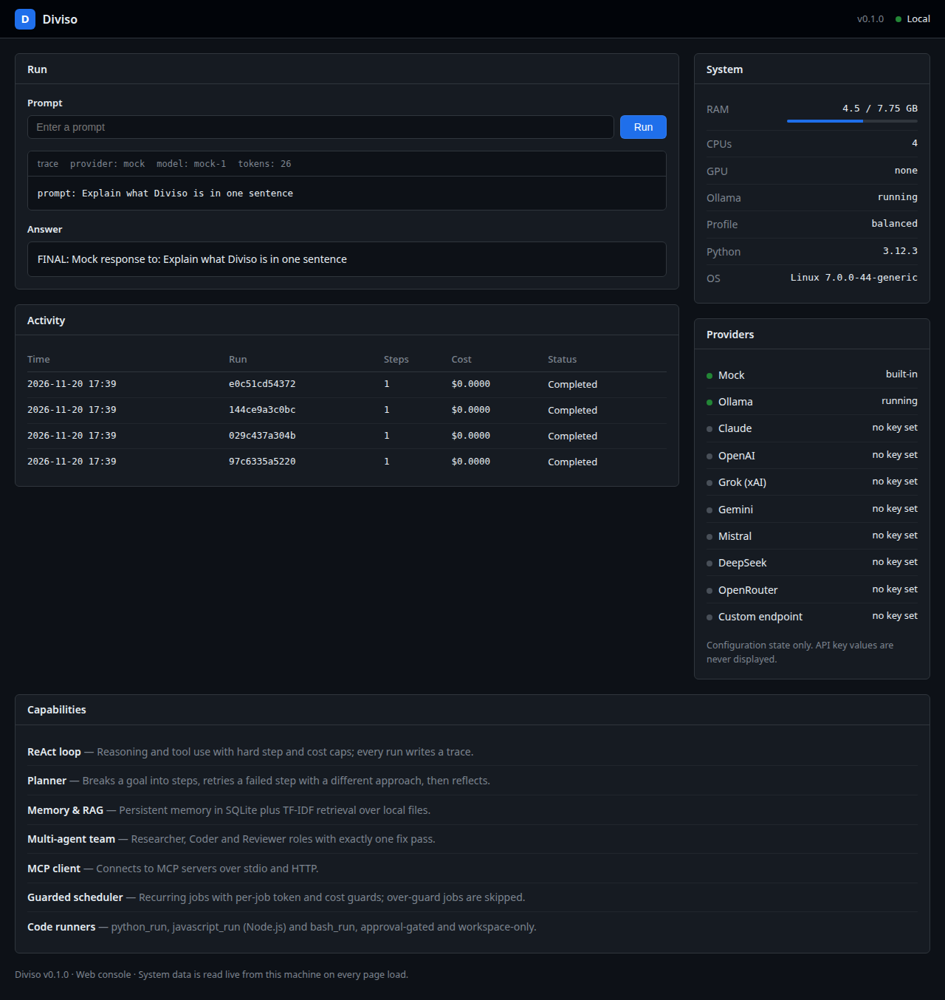

# Diviso

[](https://github.com/Neuzant/diviso-agent/actions/workflows/ci.yml)
[](LICENSE)
[](pyproject.toml)


**A local-first AI agent that runs on your own machine — with any model, under your control, no cloud account required.**

Diviso runs fully locally. Your data stays on your device. Bring a local
model through Ollama, or plug in any provider by API key: OpenAI, Claude,
Grok (xAI), Gemini, Mistral, DeepSeek, OpenRouter, or any
OpenAI-compatible endpoint. It runs on Android (Termux), low-end PCs and
high-end GPU machines, with lite / balanced / pro profiles that adapt to
your hardware.

## 60-second quickstart

Requires Python 3.10+. No third-party packages are needed for the core.

```bash
git clone https://github.com/modivicky53-code/diviso-agent.git
cd diviso-agent
pip install -e .
diviso doctor
diviso run --provider mock "Explain what Diviso is in one sentence"
```

The `mock` provider is deterministic and works fully offline — it proves
the install, the agent loop and the tracing end-to-end with no API key and
no network. To use a real local model, install
[Ollama](https://ollama.com), run `ollama pull llama3.2:1b`, then:

```bash
diviso run --provider ollama --model llama3.2:1b "Write a haiku about monsoons"
```

To use a cloud model, set its key in the environment (never in a file
Diviso writes):

```bash
export OPENAI_API_KEY=...        # or ANTHROPIC_API_KEY, XAI_API_KEY,
                                 # GEMINI_API_KEY, MISTRAL_API_KEY,
                                 # DEEPSEEK_API_KEY, OPENROUTER_API_KEY
diviso run --provider openai "Summarise this week's plan"
```

## See it running

Real screenshots of the Diviso web dashboard (`diviso serve`), captured
from the app running locally — no mockups. The system values shown in
the dashboard (RAM, CPUs, GPU, Ollama, profile) are detected live from
the machine serving the page.



A live run from the dashboard, with its trace (provider, model, tokens)
and the agent's answer:



The Doctor page reports the raw hardware detection behind the profile
choice:


## Features

| Capability | Diviso | OpenClaw | Hermes Agent | OpenCode |
|---|---|---|---|---|
| Runs fully locally, no cloud account required | Yes | Yes (self-hosted gateway) | Yes (self-hosted) | Yes (local CLI) |
| Local models via Ollama | Yes | Via configured providers | Via configured providers | Via configured providers |
| OpenAI / Claude / Grok / Gemini / Mistral / DeepSeek / OpenRouter in one client surface | Yes | Yes | Yes | Yes |
| Hardware auto-detection with lite/balanced/pro profiles | Yes | No | No | No |
| Approval gate with dry-run diffs before writes/shell/network | Yes | Partial (tool policies) | Partial (approvals) | Partial (permissions) |
| Workspace sandbox (writes cannot escape the project) | Yes | Partial | Partial | Partial |
| Checkpoint after every step + resume crashed runs | Yes | No | Partial | No |
| Scheduler with per-job token/cost guards | Yes | Partial (cron) | Partial (cron) | No |
| Persistent memory (SQLite + plain MEMORY.md) | Yes | Yes | Yes | No |
| RAG over local files | Yes | Partial | Partial | No |
| Multi-agent team (Researcher/Coder/Reviewer) | Yes | Partial | Partial | Partial (subagents) |
| MCP client (stdio + HTTP) | Yes | Yes | Yes | Yes |
| Skills as local SKILL.md files only (never downloaded) | Yes | Yes | Yes | Partial |
| Core runs on Python stdlib only (Termux-friendly) | Yes | No (Node.js) | No | No (binary/Node) |

"Partial" means the capability exists in a different or narrower form in
that project's public documentation; the Diviso column lists only what is
implemented and tested in this repository.

## Architecture

```
src/diviso/
  config.py       env + diviso.toml/json config; keys from env only, redacted in logs
  hardware.py     RAM/CPU/GPU + Ollama detection, lite/balanced/pro profiles,
                  graceful degradation when a model is too big for the device
  providers/      base interface + Ollama, OpenAI-compatible (OpenAI, xAI,
                  Gemini, Mistral, DeepSeek, OpenRouter, custom), Anthropic, mock
  agent/          ReAct loop (hard step + cost caps, visible trace) and a
                  planner that retries failed steps with a different approach
                  and reflects on the result
  memory/         SQLite store + MEMORY.md sync; TF-IDF RAG over local files
  team/           Researcher / Coder / Reviewer with exactly one fix pass
  tools/          python_run, javascript_run (Node.js, when installed),
                  bash_run, file_write (with diff), run_tests, read-only git,
                  web_fetch, web_search — all behind the approval gate
  safety.py       approval gate (dry-run diff before any write/shell/network
                  action) + workspace sandbox
  checkpoint.py   state saved after every step; resume by run id
  trace.py        streaming JSONL trace log per run
  scheduler.py    jobs with per-job max_tokens / max_cost guards — a job that
                  would exceed its guard is skipped and logged
  plugins.py      local plugin loader (manifest + register())
  mcp_client.py   MCP client over stdio and HTTP (JSON-RPC)
  skills.py       SKILL.md loader — local files only, remote URLs rejected
  cli.py          run / chat / doctor / memory / schedule / resume / serve
  webui.py        small web UI on the stdlib http.server
```

## Profiles

| Profile | Hardware guide | Suggested local models |
|---|---|---|
| lite | Under ~6 GB RAM, phones (Termux), old laptops | qwen2.5:0.5b, llama3.2:1b, qwen2.5:1.5b |
| balanced | ~6–16 GB RAM | qwen2.5:7b, llama3.1:8b, mistral:7b |
| pro | 16 GB+ RAM or a GPU | qwen2.5:32b, llama3.1:70b, qwen2.5-coder:32b |

`diviso doctor` detects your machine, picks a profile, and — if you named
a model that cannot fit in RAM — suggests the largest model that does
instead of failing.

## Safety model

- **Approval gate:** every write, shell or network action first produces a
  dry-run description (a unified diff for file writes) and runs only after
  approval. Auto-approve exists but must be switched on explicitly
  (`--yes` or `auto_approve` in config). With no approver configured,
  mutations are denied by default.
- **Sandbox:** file tools resolve paths and refuse anything outside the
  workspace root, including `..` traversal.
- **Read-only git:** only `status`, `log`, `diff`, `show` and other
  read-only subcommands; mutating subcommands are rejected.
- **Cost caps everywhere:** the ReAct loop stops at `max_steps` /
  `max_cost_usd`; scheduled jobs carry their own token/cost guards.
- **Local-only skills and plugins:** Diviso never downloads a skill or
  plugin from the internet.

## More commands

```bash
diviso chat                                   # interactive REPL
diviso memory add editor vim                  # persistent fact (SQLite + MEMORY.md)
diviso memory list
diviso schedule add --name nightly --prompt "Summarise today's notes" \
    --max-tokens 4000 --max-cost 0.10         # guarded scheduled job
diviso resume <run-id>                        # inspect a checkpointed run
diviso serve --port 8765                      # web UI at http://127.0.0.1:8765
```

## Install scripts

- Linux/macOS: `./install.sh`
- Windows: `./install.ps1`
- Android Termux: `./install-termux.sh`
- Docker: `docker build -t diviso . && docker run --rm diviso doctor`

## Roadmap

- Streaming responses from network providers in the CLI and web UI
- Vector-embedding RAG as an optional extra (core stays TF-IDF, stdlib-only)
- Signed plugin manifests and a local plugin registry format
- Voice input/output on Termux and desktop
- More MCP transports (WebSocket) and an MCP server mode for Diviso's tools
- Scheduled-job daemon mode with system service files

## Development

```bash
pip install -e ".[dev]"
python -m pytest -q
```

## License

MIT — see [LICENSE](LICENSE). Contributing: see
[CONTRIBUTING](CONTRIBUTING.md). Security: see [SECURITY](SECURITY.md).
