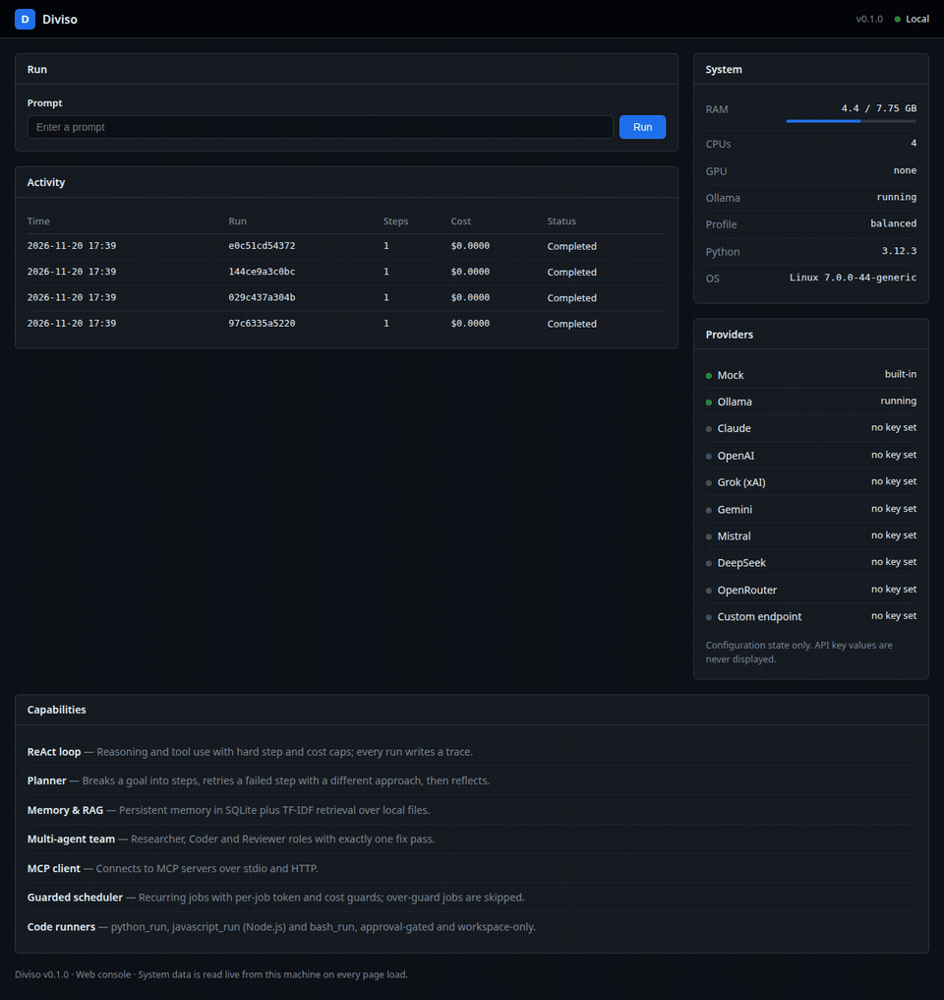
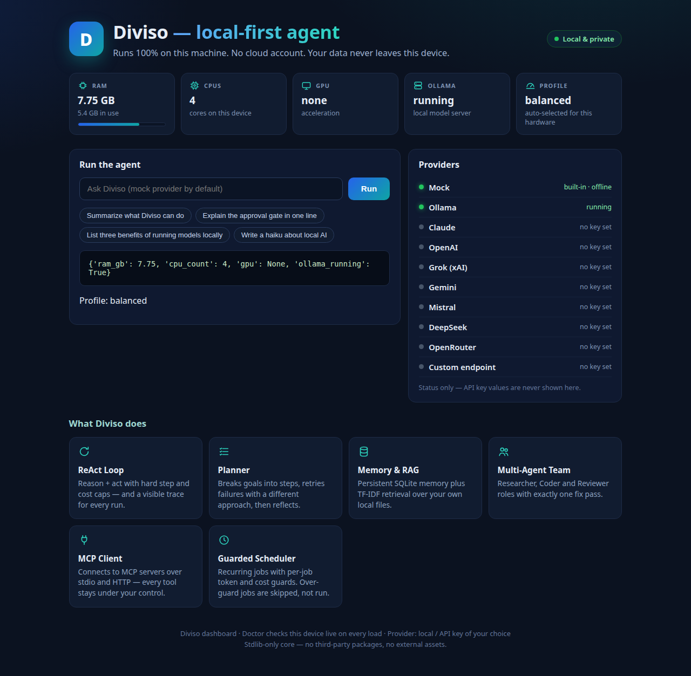
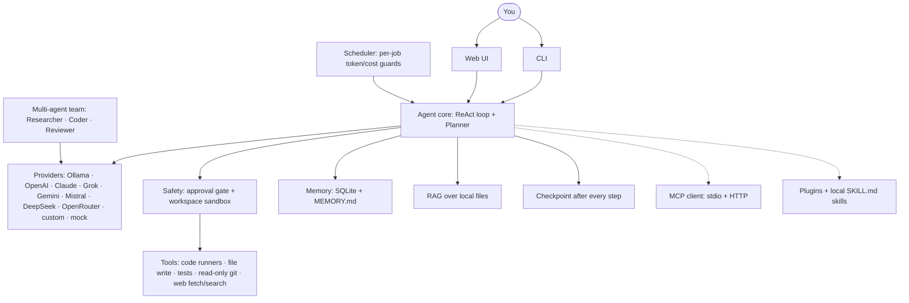

<div align="center">

# Diviso

**A local-first AI agent that runs on your own machine — with any model, under your control, no cloud account required.**

[](https://github.com/Neuzant/diviso-agent/actions/workflows/ci.yml)
[](https://github.com/Neuzant/diviso-agent/releases)
[](https://github.com/Neuzant/diviso-agent/stargazers)
[](LICENSE)
[](pyproject.toml)




<sub>The Diviso web dashboard, a live run with its trace, and the doctor page — real captures from the running app.</sub>

</div>

Diviso runs fully locally. Your data stays on your device. Bring a local
model through Ollama, or plug in any provider by API key: OpenAI, Claude,
Grok (xAI), Gemini, Mistral, DeepSeek, OpenRouter, or any
OpenAI-compatible endpoint. It runs on Android (Termux), low-end PCs and
high-end GPU machines, with lite / balanced / pro profiles that adapt to
your hardware.

## 60-second quickstart

Requires Python 3.10+. No third-party packages are needed for the core.

```bash
git clone https://github.com/Neuzant/diviso-agent.git
cd diviso-agent
pip install -e .
diviso doctor
diviso run --provider mock "Explain what Diviso is in one sentence"
```

The `mock` provider is deterministic and works fully offline — it proves
the install, the agent loop and the tracing end-to-end with no API key and
no network. To use a real local model, install
[Ollama](https://ollama.com), run `ollama pull llama3.2:1b`, then:

```bash
diviso run --provider ollama --model llama3.2:1b "Write a haiku about monsoons"
```

To use a cloud model, set its key in the environment (never in a file
Diviso writes):

```bash
export OPENAI_API_KEY=...        # or ANTHROPIC_API_KEY, XAI_API_KEY,
                                 # GEMINI_API_KEY, MISTRAL_API_KEY,
                                 # DEEPSEEK_API_KEY, OPENROUTER_API_KEY
diviso run --provider openai "Summarise this week's plan"
```

## Why Diviso

- **Local-first by design.** The agent, its memory and its traces live on
  your machine. With a local model, nothing leaves the device at all.
- **Any model, one surface.** Ollama locally, seven cloud providers by API
  key, and any OpenAI-compatible endpoint — switch with one flag.
- **No account, no sign-up.** Install it and run it. There is no Diviso
  server to register with.
- **Runs where you are.** The core is Python stdlib only, so the same code
  runs on a GPU workstation, an old laptop, and a phone under Termux —
  hardware detection picks a lite / balanced / pro profile for the device.
- **Safety you can inspect.** Writes, shell commands and network calls go
  through an approval gate with dry-run diffs, inside a workspace sandbox,
  with hard step and cost caps on every run.

## See it running

Real screenshots of the Diviso web dashboard (`diviso serve`), captured
from the app running locally — no mockups. The system values shown in
the dashboard (RAM, CPUs, GPU, Ollama, profile) are detected live from
the machine serving the page.


A live run from the dashboard, with its trace (provider, model, tokens)
and the agent's answer:


The Doctor page reports the raw hardware detection behind the profile
choice:



## Features

| Area | What you get |
|---|---|
| Agent loop | ReAct loop with hard step and cost caps and a visible trace for every run |
| Planning | Planner that breaks a goal into steps, retries a failed step with a different approach, and reflects on the result |
| Providers | Ollama, OpenAI, Claude (Anthropic), Grok (xAI), Gemini, Mistral, DeepSeek, OpenRouter, any OpenAI-compatible endpoint, plus a deterministic offline mock |
| Hardware profiles | Automatic RAM/CPU/GPU and Ollama detection; lite / balanced / pro profiles; a model that cannot fit is replaced with the largest that does |
| Tools | `python_run`, `javascript_run` (Node.js, when installed), `bash_run`, file write with diff, test runner, read-only git, web fetch and web search |
| Safety | Approval gate with dry-run diffs before writes/shell/network, workspace sandbox, read-only git |
| Memory | Persistent memory in SQLite, mirrored to a plain `MEMORY.md` you can read and edit |
| Retrieval | TF-IDF RAG over your local files — no embeddings service, no uploads |
| Multi-agent team | Researcher / Coder / Reviewer roles with exactly one fix pass |
| Checkpoints | State saved after every step; a crashed or stopped run resumes by run id |
| Scheduler | Recurring jobs with per-job token and cost guards — an over-guard job is skipped and logged, not run |
| Plugins & skills | Local plugin loader, and SKILL.md skills loaded from local files only (remote URLs are rejected) |
| MCP | MCP client over stdio and HTTP (JSON-RPC) |
| Interfaces | CLI (`run`, `chat`, `doctor`, `memory`, `schedule`, `resume`, `serve`) and a web UI on the stdlib `http.server` |
| Tracing | Streaming JSONL trace log per run, plus a live activity view in the dashboard |

## How Diviso compares

|  | Diviso | Typical cloud agent tool | Plain local scripts |
|---|---|---|---|
| Account required | No | Yes | No |
| Data leaves your device | Only the prompts you send to a cloud provider you chose; with a local model, nothing | Yes — runs and data live on the vendor's servers | No |
| Model choice | Local Ollama models, 7 cloud providers, any OpenAI-compatible endpoint | The vendor's models | Whatever you wire up yourself |
| Runs on-device on Android (Termux) | Yes — stdlib-only core, lite profile | No | Only if you port them yourself |
| Built-in cost caps | Yes — per run, and per scheduled job | Usually plan or usage limits, not per-run caps | No |
| Persistent memory | Yes — SQLite + `MEMORY.md` + local RAG | Sometimes, stored on vendor servers | No |

The middle column describes the common pattern of hosted agent products
as a category; the Diviso column lists only what is implemented and
tested in this repository.

## Architecture



Every run flows through the same agent core, whichever interface starts
it. The core talks to one provider at a time, and every tool call passes
the safety layer before it can touch the workspace. Memory, checkpoints
and traces are plain local state (SQLite, JSON and JSONL under
`~/.diviso`), so you can inspect or delete them at any time. The team,
scheduler and MCP client are separate modules built on the same provider
interface, not parallel implementations.

<details>
<summary>Module map (src/diviso/)</summary>

```
config.py       env + diviso.toml/json config; keys from env only, redacted in logs
hardware.py     RAM/CPU/GPU + Ollama detection, lite/balanced/pro profiles,
                graceful degradation when a model is too big for the device
providers/      base interface + Ollama, OpenAI-compatible (OpenAI, xAI,
                Gemini, Mistral, DeepSeek, OpenRouter, custom), Anthropic, mock
agent/          ReAct loop (hard step + cost caps, visible trace) and a
                planner that retries failed steps with a different approach
                and reflects on the result
memory/         SQLite store + MEMORY.md sync; TF-IDF RAG over local files
team/           Researcher / Coder / Reviewer with exactly one fix pass
tools/          python_run, javascript_run (Node.js, when installed),
                bash_run, file_write (with diff), run_tests, read-only git,
                web_fetch, web_search — all behind the approval gate
safety.py       approval gate (dry-run diff before any write/shell/network
                action) + workspace sandbox
checkpoint.py   state saved after every step; resume by run id
trace.py        streaming JSONL trace log per run
scheduler.py    jobs with per-job max_tokens / max_cost guards — a job that
                would exceed its guard is skipped and logged
plugins.py      local plugin loader (manifest + register())
mcp_client.py   MCP client over stdio and HTTP (JSON-RPC)
skills.py       SKILL.md loader — local files only, remote URLs rejected
cli.py          run / chat / doctor / memory / schedule / resume / serve
webui.py        small web UI on the stdlib http.server
```

</details>

## Profiles

| Profile | Hardware guide | Suggested local models |
|---|---|---|
| lite | Under ~6 GB RAM, phones (Termux), old laptops | qwen2.5:0.5b, llama3.2:1b, qwen2.5:1.5b |
| balanced | ~6–16 GB RAM | qwen2.5:7b, llama3.1:8b, mistral:7b |
| pro | 16 GB+ RAM or a GPU | qwen2.5:32b, llama3.1:70b, qwen2.5-coder:32b |

`diviso doctor` detects your machine, picks a profile, and — if you named
a model that cannot fit in RAM — suggests the largest model that does
instead of failing.

## Safety model

- **Approval gate:** every write, shell or network action first produces a
  dry-run description (a unified diff for file writes) and runs only after
  approval. Auto-approve exists but must be switched on explicitly
  (`--yes` or `auto_approve` in config). With no approver configured,
  mutations are denied by default.
- **Sandbox:** file tools resolve paths and refuse anything outside the
  workspace root, including `..` traversal.
- **Read-only git:** only `status`, `log`, `diff`, `show` and other
  read-only subcommands; mutating subcommands are rejected.
- **Cost caps everywhere:** the ReAct loop stops at `max_steps` /
  `max_cost_usd`; scheduled jobs carry their own token/cost guards.
- **Local-only skills and plugins:** Diviso never downloads a skill or
  plugin from the internet.

## Install

**Linux / macOS**

```bash
git clone https://github.com/Neuzant/diviso-agent.git
cd diviso-agent
./install.sh
```

**Windows (PowerShell)**

```powershell
git clone https://github.com/Neuzant/diviso-agent.git
cd diviso-agent
./install.ps1
```

**Android (Termux)**

```bash
pkg install python git
git clone https://github.com/Neuzant/diviso-agent.git
cd diviso-agent
./install-termux.sh
```

**Docker**

```bash
docker build -t diviso .
docker run --rm diviso doctor
```

Or skip the scripts: `pip install -e .` from a clone works everywhere
Python 3.10+ does.

## More commands

```bash
diviso chat                                   # interactive REPL
diviso memory add editor vim                  # persistent fact (SQLite + MEMORY.md)
diviso memory list
diviso schedule add --name nightly --prompt "Summarise today's notes" \
    --max-tokens 4000 --max-cost 0.10         # guarded scheduled job
diviso resume <run-id>                        # inspect a checkpointed run
diviso serve --port 8765                      # web UI at http://127.0.0.1:8765
```

## FAQ

**Do I need an internet connection?**
No — not for the agent itself. With the mock provider or a local Ollama
model, Diviso works fully offline. You only need a network for cloud
providers and for the web fetch/search tools.

**Which models can I use?**
Any model Ollama can run locally, plus OpenAI, Claude, Grok (xAI),
Gemini, Mistral, DeepSeek and OpenRouter by API key, plus anything behind
an OpenAI-compatible endpoint. `diviso doctor` suggests local models that
fit your hardware.

**Where does my data go?**
Memory, traces, checkpoints and config live under `~/.diviso` on your
machine, in formats you can open (SQLite, Markdown, JSONL). With a local
model, nothing leaves the device. With a cloud provider, the prompts for
that run go to that provider, under its terms — Diviso itself has no
server and phones nothing home.

**Does it run on Windows?**
Yes. `install.ps1` installs it on Windows with Python 3.10+; the Docker
route works there too.

**Does it really run on a phone?**
Yes — under Termux on Android. The core uses only the Python standard
library, and the lite profile targets small models that fit in a phone's
RAM. `install-termux.sh` sets it up.

**What does it cost?**
Diviso is free and MIT-licensed. Local models cost nothing beyond your
hardware. Cloud providers bill you under their own pricing — and Diviso's
step/cost caps stop a run at the limit you set instead of letting it
spend past it.

## Roadmap

- Token streaming from providers in the CLI and web UI (today, responses
  arrive whole)
- End-to-end verification against a live local model in CI, alongside the
  offline mock test suite
- Broader provider coverage behind the same provider interface
- Optional vector-embedding RAG as an installable extra (the core stays
  TF-IDF and stdlib-only)
- An MCP server mode that exposes Diviso's own tools to other clients

## Development

```bash
pip install -e ".[dev]"
python -m pytest -q
```

## Contributing

Contributions are welcome — see [CONTRIBUTING](CONTRIBUTING.md) for the
house rules (stdlib-only core, tests with every feature, no secrets).
Security issues: see [SECURITY](SECURITY.md).

## License

MIT — see [LICENSE](LICENSE).
